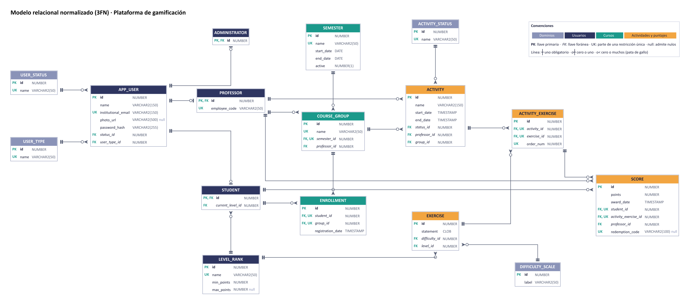
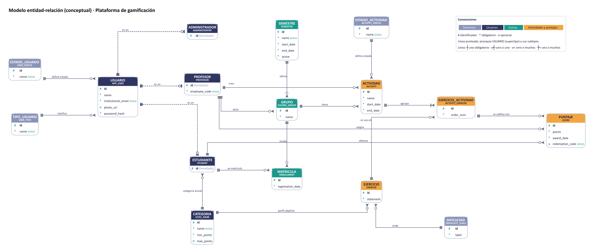

# Modelo relacional

Modelo relacional normalizado (3FN) implementado en [`src/01_ddl.sql`](../src/01_ddl.sql). El diagrama oficial se generó a partir del diccionario de datos de la base Oracle real (`USER_TAB_COLUMNS` y `USER_CONSTRAINTS`), así que coincide con el DDL columna por columna:

- Modelo relacional: [`model/mr/MR_3FN.pdf`](../model/mr/MR_3FN.pdf) ([PNG](../model/mr/MR_3FN.png))
- Modelo conceptual: [`model/mer/MER_conceptual.pdf`](../model/mer/MER_conceptual.pdf) ([PNG](../model/mer/MER_conceptual.png))
- Fuentes de Oracle Data Modeler: [`model/datamodeler/`](../model/datamodeler/) (`.dmd`, zip y PDF del MER y del MR)
- Justificación de la normalización: [`normalizacion_3FN.md`](normalizacion_3FN.md)

## Cambios atendiendo la retroalimentación

| Antes | Ahora | Motivo |
|---|---|---|
| `APP_USER.status` VARCHAR2 | `APP_USER.status_id` referencia `USER_STATUS` | Retroalimentación: estados como tabla de dominio |
| `APP_USER.user_type` VARCHAR2 | `APP_USER.user_type_id` referencia `USER_TYPE` | Retroalimentación: tipos como tabla de dominio |
| `ACTIVITY.status` VARCHAR2 | `ACTIVITY.status_id` referencia `ACTIVITY_STATUS` | Retroalimentación: estados como tabla de dominio |
| `EXERCISE.difficulty` NUMBER | `EXERCISE.difficulty_id` referencia `DIFFICULTY_SCALE` (0 a 10) | Dominio cerrado de la HU-09 |
| `SCORE.group_id` | Eliminado | Dependencia transitiva `activity_exercise_id → activity_id → group_id` (violaba la 3FN) |
| Nombre de grupo sin regla | `UNIQUE (name, semester_id)` | Duda del G3 en dos semestres: se repite entre semestres, no dentro del mismo |
| Varios semestres podían estar activos | Índice único funcional `uq_semester_active_only_one` | HU-07: un solo semestre activo |
| Sin límite en `password_hash` | `CHECK (LENGTH(password_hash) >= 60)` | HU-01 y HU-05: se guarda un hash, nunca la contraseña |
| `redemption_code` sin restricción | Único | HU-10: un código no se redime dos veces |
| Orden de ejercicios sin regla | `UNIQUE (activity_id, order_num)` | Dos ejercicios no ocupan la misma posición en una actividad |

## Diagrama

Versión vectorial: [`MR_3FN.pdf`](../model/mr/MR_3FN.pdf). Modelo conceptual equivalente:

## Tablas

La llave primaria de todas las tablas es `id`. En los subtipos `ADMINISTRATOR`, `PROFESSOR` y `STUDENT` esa llave es además foránea hacia `APP_USER` (estrategia de herencia: una tabla por subtipo).

| Módulo | Tabla | Columnas | Llaves foráneas | Unicidad y reglas |
|---|---|---|---|---|
| Dominios | USER_TYPE | id, name | | name único |
| Dominios | USER_STATUS | id, name | | name único |
| Dominios | ACTIVITY_STATUS | id, name | | name único |
| Dominios | DIFFICULTY_SCALE | id, label | | id entre 0 y 10 |
| Usuarios | LEVEL_RANK | id, name, min_points, max_points | | name único, min_points ≥ 0, max_points nulo o ≥ min_points |
| Usuarios | APP_USER | id, name, institutional_email, photo_url, password_hash, status_id, user_type_id | status_id → USER_STATUS, user_type_id → USER_TYPE | correo único, hash de 60 caracteres o más |
| Usuarios | ADMINISTRATOR | id | id → APP_USER (ON DELETE CASCADE) | |
| Usuarios | PROFESSOR | id, employee_code | id → APP_USER (ON DELETE CASCADE) | employee_code único |
| Usuarios | STUDENT | id, current_level_id | id → APP_USER (ON DELETE CASCADE), current_level_id → LEVEL_RANK | |
| Cursos | SEMESTER | id, name, start_date, end_date, active | | name único, active 0 o 1, un solo activo, end_date ≥ start_date |
| Cursos | COURSE_GROUP | id, name, semester_id, professor_id | semester_id → SEMESTER, professor_id → PROFESSOR | (name, semester_id) único |
| Cursos | ENROLLMENT | id, student_id, group_id, registration_date | student_id → STUDENT, group_id → COURSE_GROUP | (student_id, group_id) único |
| Actividades | EXERCISE | id, statement, difficulty_id, level_id | difficulty_id → DIFFICULTY_SCALE, level_id → LEVEL_RANK | statement CLOB obligatorio |
| Actividades | ACTIVITY | id, name, start_date, end_date, status_id, professor_id, group_id | status_id → ACTIVITY_STATUS, professor_id → PROFESSOR, group_id → COURSE_GROUP | end_date ≥ start_date |
| Actividades | ACTIVITY_EXERCISE | id, activity_id, exercise_id, order_num | activity_id → ACTIVITY (ON DELETE CASCADE), exercise_id → EXERCISE | (activity_id, exercise_id) único, (activity_id, order_num) único, order_num > 0 |
| Puntajes | SCORE | id, points, award_date, student_id, activity_exercise_id, professor_id, redemption_code | student_id → STUDENT, activity_exercise_id → ACTIVITY_EXERCISE, professor_id → PROFESSOR | (student_id, activity_exercise_id) único, redemption_code único, points > 0 |

Totales verificados en Oracle: 16 tablas, 16 llaves primarias, 20 llaves foráneas, 13 restricciones UNIQUE, 9 CHECK con nombre, 1 índice único funcional y 10 índices sobre llaves foráneas.

## Decisiones de diseño y alcance

1. **Herencia de usuarios con una tabla por subtipo.** Los datos comunes (nombre, correo, contraseña, estado) están una sola vez en APP_USER y cada subtipo guarda solo lo suyo: `employee_code` del profesor y `current_level_id` del estudiante. Así se evitan columnas nulas que no aplican a un rol.
2. **Tablas de dominio en lugar de texto libre.** Los estados, tipos, dificultad y categorías son catálogos con FK, lo que impide valores inválidos y permite cambiar una etiqueta en un solo lugar.
3. **Categorías configurables.** Los rangos de Principiante (0 a 99), Killer (100 a 299) y Pro (300 o más) son filas de LEVEL_RANK, no constantes en el código; cumple el criterio "las reglas de clasificación son configurables" de la HU-15.
4. **`current_level_id` en STUDENT.** Es un valor derivable de los puntos, pero se almacena para mostrar la categoría en el perfil sin recalcular (HU-15). Su consistencia la garantiza el trigger `trg_score_actualiza_nivel` y el procedimiento `sp_recalcular_niveles`, no la aplicación.
5. **ACTIVITY_EXERCISE con llave sustituta.** Resuelve la relación muchos a muchos entre actividad y ejercicio y permite que SCORE referencie "el ejercicio X dentro de la actividad Y" con una sola FK. La llave natural `(activity_id, exercise_id)` se mantiene como UNIQUE.
6. **Grupo de un puntaje por navegación.** El grupo se obtiene por `SCORE → ACTIVITY_EXERCISE → ACTIVITY → COURSE_GROUP`, sin duplicarlo en SCORE.
7. **Alcance HU-09.** La historia permite asociar un ejercicio a varios perfiles. El modelo asocia cada ejercicio a un perfil objetivo (`EXERCISE.level_id`) porque así se definieron los datos y reportes; si se requiriera más de uno, se agregaría una tabla `EXERCISE_LEVEL (exercise_id, level_id)` sin afectar el resto del modelo.
8. **Alcance HU-17.** La trazabilidad de ediciones y eliminaciones de usuarios corresponde a la capa de aplicación. En la base de datos se resolvería con una tabla de auditoría alimentada por un trigger sobre APP_USER.
