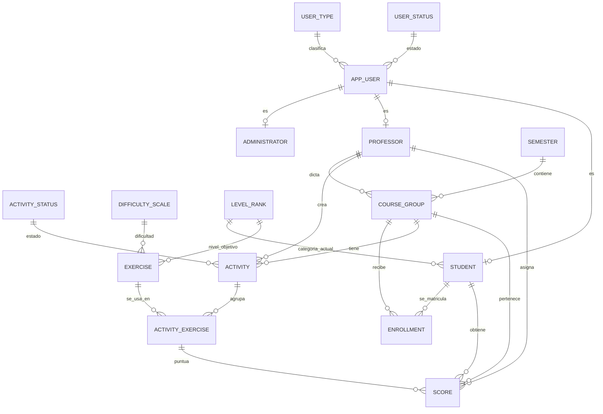

# Modelo relacional corregido
Atiende las correcciones de la retroalimentación: los atributos de estado pasan a tablas de dominio y el modelo se presenta ordenado por módulos para que sea legible. La duda sobre el grupo G3 en dos semestres se resuelve con `UNIQUE (name, semester_id)`: el nombre se puede repetir en semestres distintos, no dentro del mismo. El modelo se implementa en `sql/01_ddl.sql`.
## Cambios respecto al modelo entregado
| Antes | Ahora |
|---|---|
| `APP_USER.status` VARCHAR2 | `APP_USER.status_id` que referencia `USER_STATUS` |
| `APP_USER.user_type` VARCHAR2 | `APP_USER.user_type_id` que referencia `USER_TYPE` |
| `ACTIVITY.status` VARCHAR2 | `ACTIVITY.status_id` que referencia `ACTIVITY_STATUS` |
| `EXERCISE.difficulty` NUMBER | `EXERCISE.difficulty_id` que referencia `DIFFICULTY_SCALE`, valores 0 a 10 |
| Sin límite en `password_hash` | CHECK de longitud mínima de 60 caracteres, para exigir un hash |
| Varios semestres podían estar activos | Índice único funcional: solo un semestre activo |
| `redemption_code` sin restricción | Único, para que un código no se use dos veces |
## Diagrama por módulos

## Tablas
La llave primaria de todas las tablas es `id`. En los subtipos `ADMINISTRATOR`, `PROFESSOR` y `STUDENT` esa llave es además foránea hacia `APP_USER`.
| Módulo | Tabla | Columnas | Llaves foráneas | Unicidad y reglas |
|---|---|---|---|---|
| Dominios | USER_TYPE | id, name | | name único |
| Dominios | USER_STATUS | id, name | | name único |
| Dominios | ACTIVITY_STATUS | id, name | | name único |
| Dominios | DIFFICULTY_SCALE | id, label | | id entre 0 y 10, label único |
| Usuarios | LEVEL_RANK | id, name, min_points, max_points | | name único, max_points nulo o mayor o igual a min_points |
| Usuarios | APP_USER | id, name, institutional_email, photo_url, password_hash, status_id, user_type_id | status_id a USER_STATUS, user_type_id a USER_TYPE | correo único, hash de 60 caracteres o más |
| Usuarios | ADMINISTRATOR | id | id a APP_USER | |
| Usuarios | PROFESSOR | id, employee_code | id a APP_USER | employee_code único |
| Usuarios | STUDENT | id, current_level_id | id a APP_USER, current_level_id a LEVEL_RANK | |
| Cursos | SEMESTER | id, name, start_date, end_date, active | | name único, un solo semestre activo, end_date posterior a start_date |
| Cursos | COURSE_GROUP | id, name, semester_id, professor_id | semester_id a SEMESTER, professor_id a PROFESSOR | (name, semester_id) único |
| Cursos | ENROLLMENT | id, student_id, group_id, registration_date | student_id a STUDENT, group_id a COURSE_GROUP | (student_id, group_id) único |
| Actividades y puntajes | EXERCISE | id, statement, difficulty_id, level_id | difficulty_id a DIFFICULTY_SCALE, level_id a LEVEL_RANK | |
| Actividades y puntajes | ACTIVITY | id, name, start_date, end_date, status_id, professor_id, group_id | status_id a ACTIVITY_STATUS, professor_id a PROFESSOR, group_id a COURSE_GROUP | end_date posterior a start_date |
| Actividades y puntajes | ACTIVITY_EXERCISE | id, activity_id, exercise_id, order_num | activity_id a ACTIVITY, exercise_id a EXERCISE | (activity_id, exercise_id) único, (activity_id, order_num) único |
| Actividades y puntajes | SCORE | id, points, award_date, student_id, activity_exercise_id, professor_id, group_id, redemption_code | student_id a STUDENT, activity_exercise_id a ACTIVITY_EXERCISE, professor_id a PROFESSOR, group_id a COURSE_GROUP | (student_id, activity_exercise_id) único, redemption_code único, points mayor que cero |
